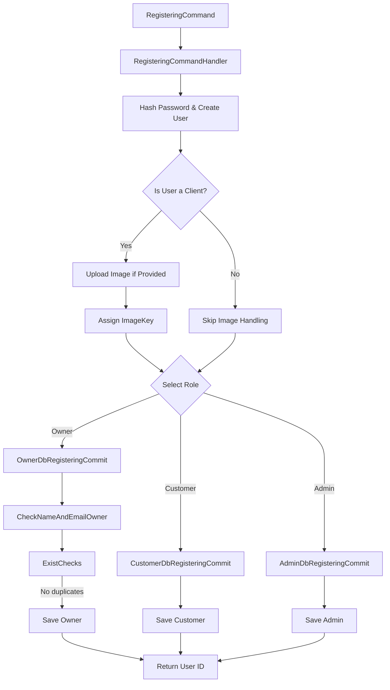

# Registering Design

The registering process uses a Strategy-like approach to handle user registration based on the selected role.

- **RegisteringCommand:** Holds the registration data.
- **RegisteringCommandHandler:** Hashes the password, creates the appropriate `User` object, handles client-specific image uploads, and selects the appropriate commit based on the requested role.
- **IDbRegisteringCommit:** Defines a shared contract for persisting users.
- **Role-specific Commits:** Each implementation handles role assignment and saving the user into its corresponding DbSet.
- **CheckNameAndEmailOwner:** Checks whether the owner's email or username already exists before registration.
- **ExistChecks:** Reuses the existence-checking logic and throws the appropriate exception when a duplicate is found.

## Client Image Handling

Image uploads are handled based on the actual user type rather than comparing role names.

Since `Customer` and `Owner` inherit from `Client`, the handler checks whether the created user is a `Client`.

```csharp
if (user is Client client)
{
    var imageKey = registeringCommand.Image is null
        ? null
        : await _uploadFileStorage.UploadAsync(
            registeringCommand.Image,
            cancellationToken);

    client.ImageKey = imageKey;
}
```

This keeps client-specific behavior tied to the inheritance structure rather than hardcoded role names.

Admins do not receive client-specific image handling.

## Role-Based Commit Selection

The `RegisteringCommandHandler` selects the appropriate `IDbRegisteringCommit` implementation using a switch expression based on the requested role.

```csharp
IDbRegisteringCommit Commiter = registeringCommand.Role switch
{
    "Customer" => _customerCommit,
    "Owner"    => _ownerCommit,
    "Admin"    => _adminCommit,
    _ => throw new UnkownRoleException(
        $"What Is {registeringCommand.Role}")
};
```

**Reasoning:**
- Uses the Strategy-like approach to select the appropriate registration implementation.
- Keeps role-specific persistence logic outside the command handler.
- Makes adding new registration roles straightforward by providing another commit implementation.
- Throws an exception when an unsupported role is requested.

## Registration Flow

